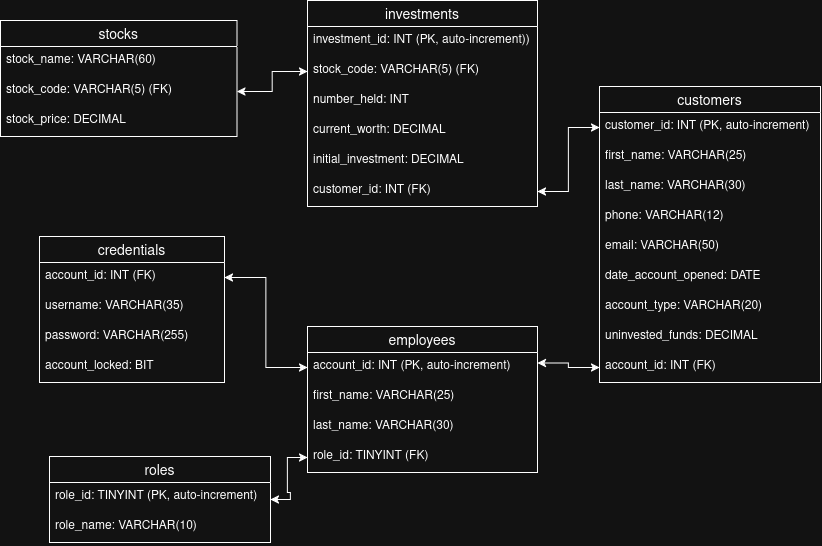

# Investment Manager

This project, created for my Computer Science Capstone, was built with the with the idea in mind that it would be used by an investment company to allow its employees to create new customers and employees, and purchase stocks for managed customers accounts. 

## Dependencies

- **CMake** version 4.4 or newer.
- **Qt** Framework version 6.2.4 or newer.
- **libsodium** library version 1.0.18 or newer.
- **MySQL** version 8.0.46 or newer.

## Build

Currently, build support is only provided for Linux Debian based systems. 

First, ensure you have installed all dependencies. Each of these dependencies can be installed using the apt package manager as follows:

```bash
sudo apt update

sudo apt upgrade

sudo apt install cmake qt6-base-dev libqt6sql6-mysql libsodium-dev mysql-client
```

*NOTE:* The original build of this program utilized a Ubuntu 24.04 LTS server to host the MySQL database. If your intention it to host the database on your computer vice a separate server, you will also need to install the package `mysql-server`.

Once all the packages are installed, clone the repo to whichever directory you desire, then from the project root run:

```bash
cmake -B build
```

Once your build files are created, you can then compile the program with:

```bash
cmake --build build
```

This will create a executable file `build/controller/Investment`. Before you are able to successfully run the program, however, you will need to set up the database and populate the `config.json` file.

## Creating the Database

Before you can run the program, you will need to create the database that it will be accessing as well as an account that has read and write access to said database.

The database should be created with the following structure:



*NOTE:* The database name, as well as the username and password can be whatever you decide. Ensure you remember what they are, as you will populate them in the `config.json` file for the program to access.

*NOTE:* Table and column names must be exactly as written in the diagram, otherwise the program will not run properly.

## Setting The Configuration Variables

In the repo there is `config.example.json`. Before running the program you will need to configure each of the variables with appropriate value. Do not change the variable names.

This program was written to use the Finnhub Stock API. Getting and API key is free and just involves making an account. The program will be unable to pull the stock list if you do not have an API key.

Once you have set the configuration variables, you are ready to run the program!

## Program Structure

This program was designed in the Model, View, Service, Controller (MVSC) layered architectural style, with the View layer connecting to the Controller layer, which connects to the Service layer, which connects to the Model layer. 

The program has three major functionality categories:
1. Initialization
2. Admin 
3. Employee

**Initialization** happens when the program is first started up, is controlled by the `MasterController`, and automatically creates the database connection, as well as updates the list of tracked stocks to the most up to date prices. This functionality also handles log in attempts and password creation for new users.

**Admin** functionality is only provided to the users that have an Admin role. From here the user is able to create, edit, or delete/deactivate customers and employees. Additionally, from here the user is able to unlock locked employee accounts and reset passwords as necessary.

**Employee** functionality is provided to users that have the Trader role. From here the user is able to see all customer accounts that they manage, as well as buy and sell stocks for a given customer.

### View Layer

The View layer has the purpose of creating the user interface and accepting user input and is comprised of the following classes:

- `AdminMainView`
- `CustomerCreationView`
- `CustomerManagerView`
- `EmployeeCreationView`
- `ErrorWindow`
- `LogInView`
- `PurchaseStockWindow`
- `SellStockWindow`
- `TraderMainView`
- `WarningWindow`

Each class corresponds to a screen or pop up window that the user will see.

The View layer communicates with the controller layer primarily through signals.

#### AdminMainView
This window is where any administrators will be directed upon log in. From here they can see a list of all employees and all customers, and they are able to create and edit employees or customers, as well as delete customer accounts and deactivate employee accounts.

Whenever the user attempts to create or edit an account, either the `CustomerCreationView` or `EmployeeCreationView` is displayed. 

#### CustomerCreationView
This window is where an administrator is able to create a new customer, or perform an edit of an existing one. 

#### CustomerManagerView
This window is where a Trader Employee is directed to when they select a customer. From here they are able to see customer information, as well as purchase or sell stocks for the given customer.

Whenever the user tries to purchase or sell stocks, the `PurchaseStockWindow` or `SellStockWindow` is displayed as applicable.

#### EmployeeCreationView
This window is where an administrator is able to create a new employee or perform an edit of an existing one. Additionally, the administrator is also able to unlock employee accounts and reset passwords from this window.

#### ErrorWindow
This window displays whenever the program encounters and error, and displays the error information for the user. It can be called from any screen whenever an error occurs.

#### LogInView
This is the first screen that the user sees upon log in. It has a couple of different states, first requiring the user to enter a username before they are able to enter a password. This is also where a new user will create their password.

#### PurchaseStockWindow
This is the window that is displayed whenever a Trader is purchasing a stock for a customer. It allows them to select a stock from a list of tracked stocks, and displays to total purchase price dependent on how many shares are being purchased.

#### SellStockWindow
This is the window from which a Trader is able to sell stocks held by the customer. It allows them to select a stock to sell and displays the result of the sell.

#### TraderMainView
This is the first window that a Trader sees after logging in. From here they see their account information, as well as the list of customer accounts they manage. They can select a customer to go to the `CustomerManagerView` for that customer.

#### WarningWindow
This window is a confirmation window that displays whenever an administrator attempts to delete or deactivate an account, giving the administrator a chance to cancel the action if desired.

### Controller Layer
The Controller layer handles telling the views what to display and the service modules what to do dependent on user input. Additionally, the controller layer formats the data returned from the service layer to a format that the views are able to display. 

The controller layer is comprised of three classes:
- `AdminController`
- `MasterController`
- `TraderController`

#### AdminController
This controller is in charge of directing operations between the `AdminView`, `CustomerCreationView`, and `EmployeeCreationView` and the `AdminService` module. Additionally, upon gaining control, this controller will verify the passed in `Authorizer` role is the appropriate role, and if not will throw an error and not allow any further access. 

#### MasterController
This controller is in charge of directing operations between the `LogInView` and the `InitService` and `LogInService` module. This controller also initializes all services, and the `CRUDModule`, and will pass by reference the applicable service module to the controller that needs it upon a successful log in. This was done to prevent multiple copies of the `CRUDModule` being created, which resulted in additional unnecessary database connections. 

#### TraderController
This controller is in charge of directing operations between the `TraderMainView`, `CustomerManagerView`, `PurchaseStockWindow`, and `SellStockWindow` and the `TraderService`. Much like the `AdminController`, it will verify the appropriate authorization before allowing any continued access.

### Service Layer
The Service layer is in charge of performing all business logic as directed by the Controller layer and is comprised of the following classes:

- `AdminService`
- `Authorizer`
- `DataManager`
- `InitService`
- `LogInService`
- `TraderService`

The `AdminService`, `InitService`, `LogInService`, and `TraderService` all interface with the model layer through the `DataManager`, resulting in only one point of contact between the model layer and the service layer.

#### AdminService
This service module handles the logic behind creating, editing, and deleting/deactivating employees and customers, as well as unlocking locked accounts and resetting passwords.

#### Authorizer
This class is a very simple class. Upon construction, a role will be set. This is the role that the `LogInService` has determined to be valid for the user attempting to log in. The set role is immutable, and is what the `AdminController` and `TraderController` will compare their roles to upon taking control. If the role set in the `Authorizer` does not match that of the controller, then the log in will be denied.

#### DataManager
This class is the interface between the service layer and the model layer. It handles formatting the passed in data into parameterized SQL queries that the model layer can run, then formatting the returned data into formats usable by the rest of the application.

#### InitService
This module handles connecting to the Stock API and pulling updated stock prices based on its internal tracked stock list. It runs once, upon initiation of the application and does not run again.

#### LogInService
This module handles log in verification, as well as verifying password requirements while creating new passwords. It also will internally track the number of unsuccessful log in attempts, and if they exceed three, then it will lock the account. 

This is also where passwords are hashed and salted using libsodium's library prior to storage within the database.

#### TraderService
This module handles the purchase and sale of stocks for a given customer, calculating the resulting transactions for display, and writing the information to the database via the `DataManager`.

### Model Layer
The Model layer exclusively handles connecting to the database and running the database queries provided by the `DataManager` in the service layer. It is comprised of only one class, the `CRUDModule`.

#### CRUDModule
This module initializes the connection to the database, reading the `config.json` file to get the credentials necessary accessing the database. Additionally, it will run the queries provided to it by the `DataManager` and return the results of the query.

### Additional Classes
Outside of the MVSC architecture, there are also several other files that provide utility functions that are used by each layer, as well as the stylesheets. The utility functions are organized into the `util` folder and the `viewUtils` folder, while the stylesheets can be found in the `res/stylesheets` folder.

Within the `util` folder there are five classes that are `structs` used to easily transport information around the application. Those are:

- `Credentials`
- `Customer`
- `Employee`
- `Investment`
- `Stock`

Each of these are their own class defining the data structure, and their purpose is self explanatory by their title.

The `Role` class is a simple `Enum` of the available roles that can be held by an account.

`HashTable` is a simple hash table that is used to store stock data for quick access. Stocks are stored within the hash table, as well as the database, but due to the fact that they are only updated once upon program initialization, I elected to have the program update the hash table with the up to date stocks, then pull from that to limit database accesses.

`QuickSort` is a custom quick sorting function. It is a template class that can be used to sort customers, employees, and investments by a variety of different parameters, chosen by passing in a comparator with the function.

Within the `viewUtils` folder there are four classes:

- `CustomerDisplayItem`
- `EmployeeDisplayItem`
- `InvestmentDisplayItem`
- `ScrollableContainer`

The `ScrollableContainer` is a view widget that contains a list of a specified type (customers, employees, or investments). The item type that will be displayed is set upon construction. If the number of items displayed exceeds the height of the screen, it will also provide scroll functionality. In addition to displaying the items and scrolling, it also provides the means by which a user can sort the items by category or search for customers by name. 

Each of the display item classes are what the `ScrollableContainer` holds, and their purpose is to format the passed in data for display.
